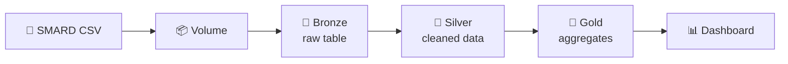

<p align="center">
  
</p>

<h3 align="center">⚡ From raw SMARD data to a renewable-energy dashboard ⚡</h3>

<p align="center">
  An end-to-end data pipeline on <b>Databricks</b> that turns six years of hourly German
  power generation data into clear, business-ready insights.
</p>

<p align="center">
  
  
  
  
  
</p>

---

## 📌 Project overview

Germany is changing how it produces electricity: more wind and solar, no nuclear, less coal.
This project answers questions such as:

- 🌱 How fast is the **renewable share** growing?
- ⚛️ How did the **generation mix** change after the nuclear phase-out?
- ☀️ At what time of day do **solar and wind** produce the most?

| | |
|---|---|
| **Data period** | Oct 2020 to Oct 2026 |
| **Resolution** | Hourly |
| **Energy sources** | 12 (wind, solar, biomass, hydro, nuclear, lignite, hard coal, gas, and more) |
| **Size** | about 53,000 hours, about 637,000 rows after reshaping |

---

## 🏗️ Architecture



| Layer | What happens |
|---|---|
| 🥉 **Bronze** | Raw CSV loaded as a Delta table, column names cleaned, metadata added |
| 🥈 **Silver** | German numbers converted, timestamps converted to UTC, wide-to-long unpivot, energy category added, quality checks, MERGE upsert |
| 🥇 **Gold** | Monthly renewable share, yearly generation mix, hourly solar and wind profile, daily generation |

---

## 📊 Dashboard

[](dashboard.pdf)

*Click the image to open the full PDF.*

---

## 🔍 Key findings

> Write only what you see in YOUR charts.

- 🌱 **[Renewable share changed from X% in 2021 to Y% in 2025]**
- ☀️ **[Solar peaks around midday, wind is more evenly spread through the day]**
- ⚛️ **[Nuclear generation dropped to zero after April 2023]**

---

## 🧠 Design decisions

| Decision | Why |
|---|---|
| Keep raw data in Bronze | Silver and Gold can be rebuilt without re-downloading |
| Store time in UTC | Avoids daylight-saving problems (missing and repeated hours) |
| Use MERGE in Silver | Re-running the notebook never creates duplicates (idempotent) |
| Run quality checks | Fails early on empty data, missing sources, or too many nulls |
| Exclude pumped storage from shares | Avoids double counting energy |

**Data quality note:** all null values were in nuclear (`kernenergie`) after the 2023 phase-out, so they were treated as no generation.

---

## 🛠️ Tech stack

- **Platform:** Databricks (Free Edition), Unity Catalog Volumes
- **Processing:** PySpark
- **Storage:** Delta Lake
- **Analytics:** Databricks SQL dashboards

---

## 📁 Repository structure

```
databricks-energy-pipeline/
├── 01_setup.py
├── 02_bronze_ingest.py
├── 03_silver_transform.py
├── 04_gold_aggregate.py
├── dashboard.png
├── dashboard.pdf
└── README.md
```

---

## ▶️ How to reproduce

1. Download hourly generation data for Germany from [smard.de](https://www.smard.de) (Downloadcenter)
2. Upload it to a Databricks Volume as `DE_generation.csv`
3. Run the notebooks in order: `01` to `04`
4. Build the dashboard from the Gold tables

---

## 📚 What I learned

- Building a medallion architecture (Bronze, Silver, Gold)
- Cleaning data with PySpark (number formats, timestamps, unpivot)
- Writing idempotent Silver loads with Delta Lake MERGE
- Turning Gold tables into a dashboard

---

## 🚀 Next steps

- Automate the pipeline with a Databricks Workflow
- Add weather data and analyze its effect on wind and solar output
- Forecast renewable generation with MLflow

---

## 🙋 About me

**[Your name]** | [LinkedIn link] | [Email]

---

<sub>**Data source:** Bundesnetzagentur | SMARD.de (check the license terms on the site)</sub>
