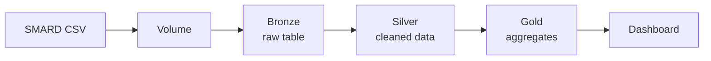

<h1 align="center">⚡ Germany Electricity Generation Pipeline</h1>

<p align="center">
  An end-to-end data pipeline on <b>Databricks</b> that turns six years of hourly German
  power generation data into clear, business-ready insights.
</p>

<p align="center">
  
  
  
  
</p>

---

## 📌 Project overview

Germany is changing how it produces electricity. This project answers questions such as:

- How fast is the **renewable share** growing?
- How did the **generation mix** change after the nuclear phase-out?
- At what time of day do **solar and wind** produce the most?

**Data:** hourly generation for 12 energy sources, Oct 2020 to Oct 2026 (about 53,000 hours, 637,000 rows after reshaping).

---

## 🏗️ Architecture



| Layer | What happens |
|---|---|
| 🥉 **Bronze** | Raw CSV loaded as a Delta table, column names cleaned, metadata added |
| 🥈 **Silver** | German numbers converted, timestamps converted to UTC, wide-to-long unpivot, energy category added, quality checks, MERGE upsert |
| 🥇 **Gold** | Monthly renewable share, yearly generation mix, hourly solar and wind profile, daily generation |

---

## 📊 Dashboard


📄 [Download the full dashboard as PDF](dashboard.pdf)

---

## 🔍 Key findings

> Write only what you see in YOUR charts.

- **[Renewable share changed from X% in 2021 to Y% in 2025]**
- **[Solar peaks around midday, wind is more evenly spread]**
- **[Nuclear generation dropped to zero after April 2023]**

---

## 🧠 Design decisions

| Decision | Why |
|---|---|
| Keep raw data in Bronze | Silver and Gold can be rebuilt without re-downloading |
| Store time in UTC | Avoids daylight-saving problems (missing and repeated hours) |
| Use MERGE in Silver | Re-running the notebook never creates duplicates |
| Run quality checks | Fails early on empty data, missing sources, or too many nulls |
| Exclude pumped storage from shares | Avoids double counting energy |

**Data quality note:** all null values were in nuclear (`kernenergie`) after the 2023 phase-out, so they were treated as no generation.

---

## 🛠️ Tech stack

- **Platform:** Databricks (Free Edition), Unity Catalog Volumes
- **Processing:** PySpark
- **Storage:** Delta Lake
- **Analytics:** Databricks SQL, dashboards

---

## 📁 Repository structure

```
databricks-energy-pipeline/
├── notebooks/
│   ├── 01_setup.py
│   ├── 02_bronze_ingest.py
│   ├── 03_silver_transform.py
│   └── 04_gold_aggregate.py
├── dashboard.png
├── dashboard.pdf
└── README.md
```

---

## ▶️ How to reproduce

1. Download hourly generation data for Germany from [smard.de](https://www.smard.de) (Downloadcenter)
2. Upload it to a Databricks Volume as `DE_generation.csv`
3. Run the notebooks in order: `01` to `04`
4. Build the dashboard from the Gold tables

---

## 📚 What I learned

- Building a medallion architecture (Bronze, Silver, Gold)
- Cleaning data with PySpark (number formats, timestamps, unpivot)
- Writing idempotent loads with Delta Lake MERGE
- Turning Gold tables into a dashboard

---

## 🙋 About me

**[Your name]** | [LinkedIn link] | [Email]

---

**Data source:** Bundesnetzagentur | SMARD.de (check the license terms on the site)
